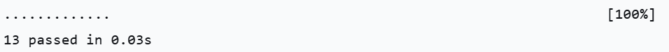

# Модуль расчёта стоимости доставки (Delivery CI)

**Студент:** Окладникова Дарья
**Группа:** 4СПИ
**Тема:** Разработка автотестов и их запуск с помощью GitHub Actions

## 📝 Описание проекта
Данный проект представляет собой Python-модуль `delivery.py` для расчёта стоимости доставки товаров. 
Функция `calculate_delivery(subtotal, express=False)` рассчитывает стоимость доставки в зависимости от суммы заказа и наличия экспресс-доставки.

**Правила расчёта:**
* При сумме заказа менее 1000 руб. — доставка 300 руб.
* При сумме от 1000 до 4999 руб. (включительно) — доставка 150 руб.
* При сумме от 5000 руб. — доставка бесплатная (0 руб.).
* Экспресс-доставка добавляет 250 руб. к базовой стоимости (даже если доставка бесплатная).
* При отрицательной сумме выбрасывается `ValueError`, при неверном типе данных — `TypeError`.

## 📂 Структура проекта
* `delivery.py` — исходный код с функцией расчёта.
* `tests/test_delivery.py` — файл с автотестами (PyTest).
* `requirements-dev.txt` — зависимости для разработки и тестирования.
* `.github/workflows/tests.yml` — конфигурация CI (GitHub Actions) для автоматического запуска тестов.
* `.gitignore` — список файлов, исключенных из репозитория.

## 🚀 Установка и локальный запуск

Для работы с проектом вам понадобится Python 3.11 или выше.

1. **Клонируйте репозиторий:**
   ```bash
   git clone https://github.com/Real-Dashuk0-28/delivery-ci.git
   cd delivery-ci

2. **Создайте и активируйте виртуальное окружение:**
Для Windows:
      ```bash
      python -m venv .venv
      .\.venv\Scripts\activate
   
3. **Установите зависимости:**
   ```bash
   pip install -r requirements-dev.txt

4. **Запуск тестов:**
     ```bash
      python -m pytest -q
   
При успешном выполнении в терминале вывод будет таким:


**Непрерывная интеграция (CI)**

Проект настроен на автоматический запуск тестов с помощью GitHub Actions.
Тесты запускаются:
* При каждом пуше (push) в ветку main.
* При создании Pull Request (pull_request) в ветку main.
* Вручную (через вкладку Actions -> Run workflow).

Отчёты о тестировании (JUnit XML) автоматически сохраняются в артефактах GitHub Actions и доступны для скачивания после каждого запуска.